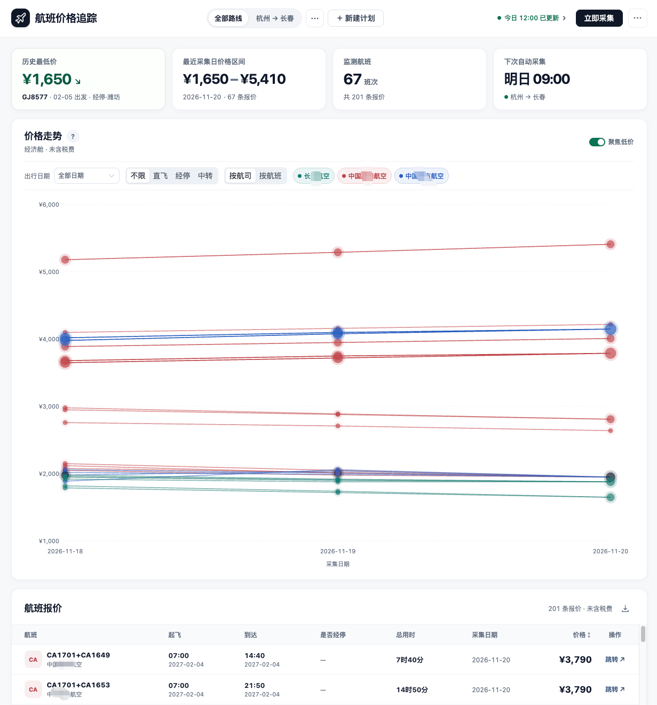

<div align="center">

# ✈️ 航班价格追踪

**一个专为多日期、多航司持续比价而生的 Chrome 本地机票追踪扩展**

自动定时抓取航司官网公开票价 · 沉淀每日历史走势 · 纯本地存储零隐私风险


<br />



</div>

---

## 🎯 为什么做这个工具？

逢年过节或提前规划行程时，出行日期往往不止一个选项。传统比价方式需要每天在不同平台之间来回切换，把每个备选日期逐一查一遍，第二天还要回忆昨天的价格判断是否降价——连续盯上几天后，往往在精力耗尽时被迫下单。

**航班价格追踪**用来终结这种重复内耗：你只需要一次性设定好**目标路线、多个备选出发日期和采集时间**，扩展会在浏览器后台自动采集航司官网公开列表价并留存历史快照，通过可视化走势图让你一眼看清「昨天贵还是今天便宜」，在合适价位一键直达官网购票。

---

## ✨ 核心特性

- **多路线与多日期并行追踪**：按中文城市名搜索国内航线（无需填写机场或三字码），单条计划支持同时选择多个目标出行日期，顶部可快速切换「全部路线」或单条计划。
- **每日自动定时采集**：支持为每条计划独立配置每日采集时间，Chrome 运行期间自动执行，也可随时在看板点击「立即采集」手动触发。
- **交互式趋势看板**：
  - 顶部 KPI 概览卡片直观呈现**历史最低价、最近采集日价格区间、监测航班与报价数、下次自动采集时间**。
  - **智能视图切换**：有报价的采集日为 1～2 天时按航司展示价格分布；满 3 天后自动切换为按采集日期展示的折线走势图。
  - **聚焦低价与点位联动**：默认聚焦常见低价区间（避免高价全价舱压缩低价视图）；同价重叠报价以大圆点标识，点击即可联动定位并高亮下方表格中的对应航班。
- **精细化筛选与一键直达**：支持按路线、出行日期、直飞／经停／中转及航司／航班多维筛选；报价表按价格升降序排列，点击操作列「跳转」直接打开航司官网实时查询页。
- **人工验证无缝接管**：遇到航司官网触发人工验证时自动暂停当前批次并保留已采数据，用户手动验证通过且列表加载稳定后自动续采，绝不尝试绕过验证。
- **纯本地存储与数据自由**：所有数据仅保存在 Chrome 本地扩展存储，不上传任何服务器；支持当前筛选结果导出 **CSV**，以及全量 **JSON** 备份与预览恢复（支持「智能合并」与「完全覆盖」）。

---

## 🛫 支持航司与数据口径

| 航司代码 | 航空公司 | 采集方式说明 |
| :---: | :--- | :--- |
| **CA** | 中国国际航空 | 按城市与日期打开官网单程结果页；仅在未读到可用列表时处理已知的普通出行提示 |
| **CZ** | 中国南方航空 | 按城市与日期打开官网单程结果页，自动解析经济舱公开报价 |
| **GJ** | 长龙航空 | 通过官网机票表单选择城市与去程日期并提交单程查询，仅记录可确认未含税的经济舱价格 |

> [!NOTE]
> **统一价格口径说明**
> - 固定查询条件：**国内单程 · 1 名成人 · 经济舱**。
> - 记录价格为航司官网展示的**人民币列表票面价（未含税费）**，扩展不推算机建燃油费或最终支付金额。
> - 报价表及导出的 CSV 包含起飞与到达的当地日期与时间、经停地点及总用时（历史旧报价中缺失的字段将保持留空）。

---

## 🚀 快速开始

### 环境要求

- Node.js & npm
- Google Chrome（支持 Manifest V3 扩展）

### 构建与安装

1. 克隆仓库并安装依赖、执行构建：

```bash
npm install
npm run build
```

2. 在 Chrome 地址栏访问 `chrome://extensions`。
3. 开启右上角的 **「开发者模式」**。
4. 点击 **「加载已解压的扩展程序」**，选择项目根目录下的 `dist/` 文件夹即可完成安装。

> [!TIP]
> 首次安装完成后，计划列表默认为空。点击浏览器工具栏中的扩展图标即可在新标签页打开完整看板，点击顶部 **「+ 新建计划」** 即可开始追踪。

---

## 📖 使用指南

### 1. 管理查询计划
- 点击顶栏 **「+ 新建计划」**，从国内城市列表中搜索出发地与到达地，勾选一个或多个出行日期，并设置每日自动采集时间。新建计划默认全选全部支持的航司，可按需取消勾选。
- 顶栏支持在「全部路线」与单条计划之间快速切换，点击计划旁的 `···` 菜单可编辑、启停或删除当前计划。

### 2. 采集执行与人工验证处理
- 点击顶栏右上角 **「立即采集」** 可立即触发采集；点击旁边的采集状态标签可展开抽屉，查看**最近 20 次采集记录**与每次任务的详细明细。
- 当航司官网触发人工验证时：
  1. 本批采集会自动暂停，此前已保存的报价完整保留。
  2. 请在原航司标签页中手动完成验证（如找不到页面，可在看板点击 **「打开验证页」** 找回）。
  3. 原航线与出行日期的有效航班列表出现并稳定后，扩展会**自动续采**，无需切回扩展操作；若未自动继续，可点击 **「手动继续」** 或 **「跳过本项」**。
  4. 暂停状态不会因扩展后台休眠而丢失，但**关闭 Chrome 或重新加载扩展后无法继续原验证会话**。

### 3. 看板筛选与官网跳转
- 图表与下方报价表共用筛选条，支持按日期、行程类型（直飞／经停／中转）、航司及具体航班筛选。历史旧报价中无法区分经停与中转的记录，可在 **「不限」** 状态下查看。
- 点击报价表 **「价格」** 表头可切换升序／降序排列；点击 **「操作」** 列的 **「跳转」**，会在新标签页打开对应航司、路线与日期的官网实时查询页（官网显示为实时价格，可能与历史快照存在差异）。

### 4. 数据导出与备份恢复
- **导出 CSV**：在航班报价表右上角一键导出当前筛选及排序结果，方便使用 Excel 进一步比价。
- **全量备份与恢复**：点击顶栏最右侧的 `···`（**数据管理**），可导出包含所有查询计划、历史报价与采集记录的 JSON 文件；采集结束后可随时导入备份并先预览校验摘要：
  - **智能合并**：保留本地同编号记录，仅补充缺失的数据。
  - **完全覆盖**：使用备份文件完整替换本地的计划、历史报价与采集记录。

---

## 🛠️ 本地开发与验证

```bash
# 运行单元测试
npm test

# 构建扩展产物至 dist/
npm run build

# 执行完整校验流程
npm run verify
```

---

## 🔒 隐私与免责声明

- **纯本地架构**：所有查询计划、历史报价与采集日志均存储于 Chrome 本地扩展存储（Local Storage），不依赖后端服务，不上传任何用户数据。
- **合规采集边界**：扩展仅读取航司官网公开展示的查询列表，**绝不执行下单操作，绝不尝试绕过验证码或人工验证，也不会保存任何猜测或推算价格**。
- **站点变更提示**：航空公司官网可能随时调整页面结构或公开查询流程，导致部分航司采集失败；各家航司的实际页面可用性需在 Chrome 实际环境中分别确认。
